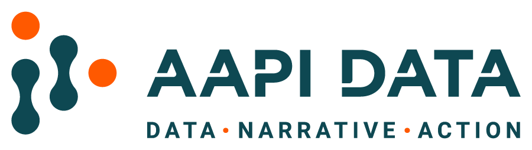

<!--
  WHAT THIS PAGE DOES (plain-language summary)
  ---------------------------------------------------------------------------
  The dashboard's home page. It is still mostly the Observable Framework
  starter page, with the dashboard's title and color scheme added:
    1. A large title banner ("hero").
    2. Two sample charts using built-in demo data (stock prices and penguin
       measurements), not AANHPI data.
    3. "Next steps" cards linking to Observable Framework documentation.
    4. Page styling (colors, borders, title size) at the bottom.
-->

<!-- AAPI Data logo, top right of the page. -->

  

<!-- Title banner at the top of the page. -->

  <h1>2026 State of AANHPIs Dashboard</h1>
  <h2>A partner data dashboard for AAPI Data's comprehensive report on the State of Asian Americans, Native Hawaiians, and Pacific Islanders in the U.S.</h2>
  <a href="https://aapidata.com/data/state-of-aanhpis-report-2026/">View report↗︎</a>

<!-- Two sample charts side by side, using demo data that comes with Observable:
     a line chart of Apple stock prices and a scatter plot of penguin sizes. -->

<!--

  
${
    resize((width) => Plot.plot({
      title: "Your awesomeness over time 🚀",
      subtitle: "Up and to the right!",
      width,
      y: {grid: true, label: "Awesomeness"},
      marks: [
        Plot.ruleY([0]),
        Plot.lineY(aapl, {x: "Date", y: "Close", stroke: "#103f48", tip: true})
      ]
    }))
  }

  
${
    resize((width) => Plot.plot({
      title: "How big are penguins, anyway? 🐧",
      width,
      grid: true,
      x: {label: "Body mass (g)"},
      y: {label: "Flipper length (mm)"},
      color: {legend: true, range: ["#103f48", "#7fb6a4", "#ff4f00"]},
      marks: [
        Plot.linearRegressionY(penguins, {x: "body_mass_g", y: "flipper_length_mm", stroke: "species"}),
        Plot.dot(penguins, {x: "body_mass_g", y: "flipper_length_mm", stroke: "species", tip: true})
      ]
    }))
  }

-->

---

<!--
## Next steps
-->

<!-- Starter-template cards with links to Observable Framework help pages. -->

<!--
Here are some ideas of things you could try…

  

    Chart your own data using <a href="https://observablehq.com/framework/lib/plot"><code>Plot</code></a> and <a href="https://observablehq.com/framework/files"><code>FileAttachment</code></a>. Make it responsive using <a href="https://observablehq.com/framework/javascript#resize(render)"><code>resize</code></a>.
  

  

    Create a <a href="https://observablehq.com/framework/project-structure">new page</a> by adding a Markdown file (<code>whatever.md</code>) to the <code>src</code> folder.
  

  

    Add a drop-down menu using <a href="https://observablehq.com/framework/inputs/select"><code>Inputs.select</code></a> and use it to filter the data shown in a chart.
  

  

    Write a <a href="https://observablehq.com/framework/loaders">data loader</a> that queries a local database or API, generating a data snapshot on build.
  

  

    Import a <a href="https://observablehq.com/framework/imports">recommended library</a> from npm, such as <a href="https://observablehq.com/framework/lib/leaflet">Leaflet</a>, <a href="https://observablehq.com/framework/lib/dot">GraphViz</a>, <a href="https://observablehq.com/framework/lib/tex">TeX</a>, or <a href="https://observablehq.com/framework/lib/duckdb">DuckDB</a>.
  

  

    Ask for help, or share your work or ideas, on our <a href="https://github.com/observablehq/framework/discussions">GitHub discussions</a>.
  

  

    Visit <a href="https://github.com/observablehq/framework">Framework on GitHub</a> and give us a star. Or file an issue if you’ve found a bug!
  

-->

<!-- Page styling. Colors used: #103f48 (dark teal, text), #ff4f00 (orange,
     links and highlights), #7fb6a4 (light green, borders), #ffffff (white). -->

